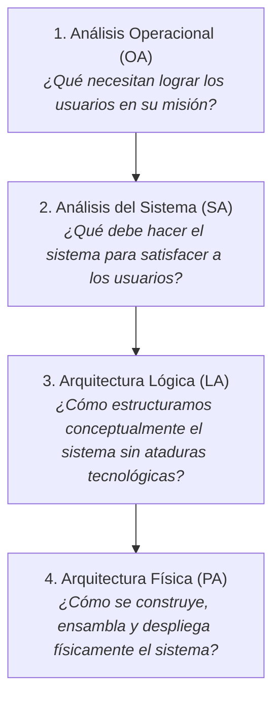
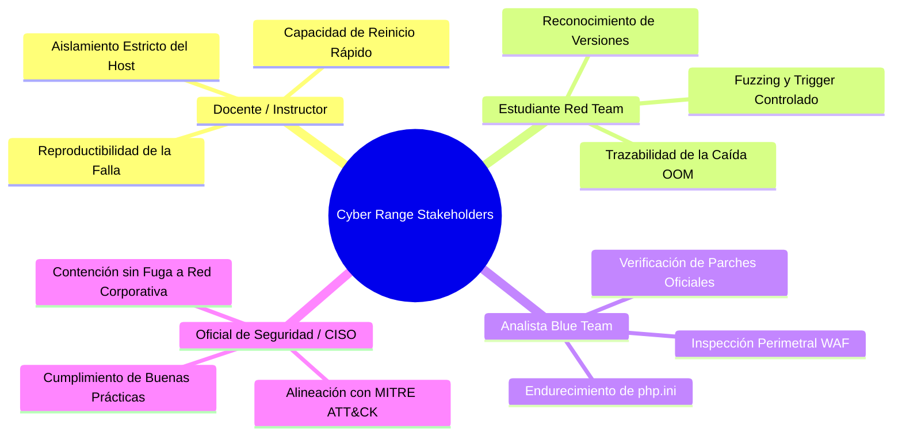
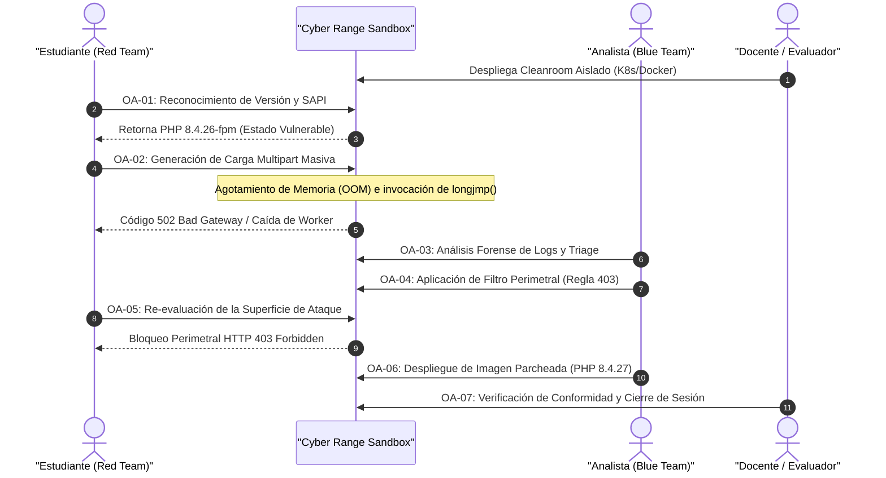
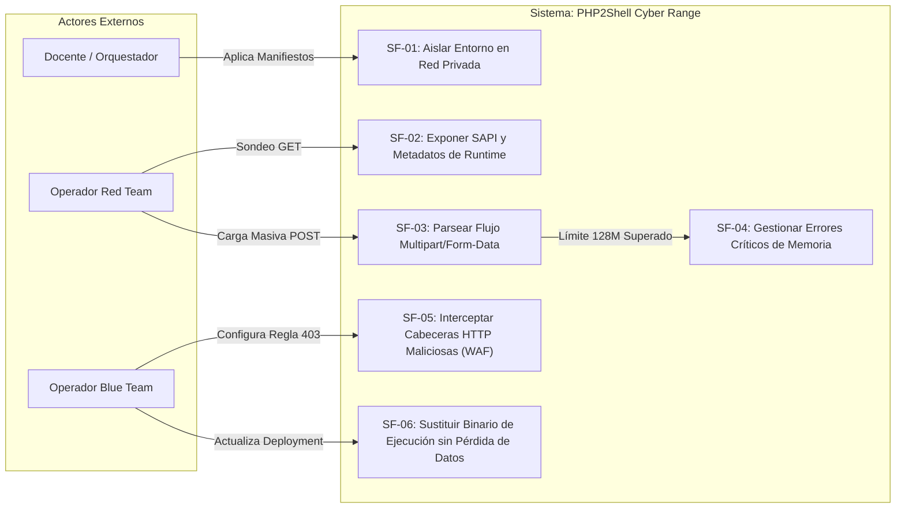
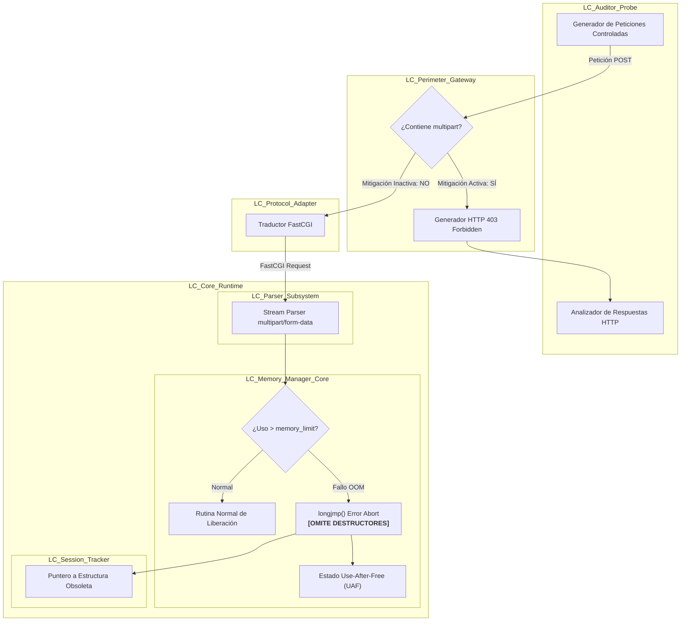
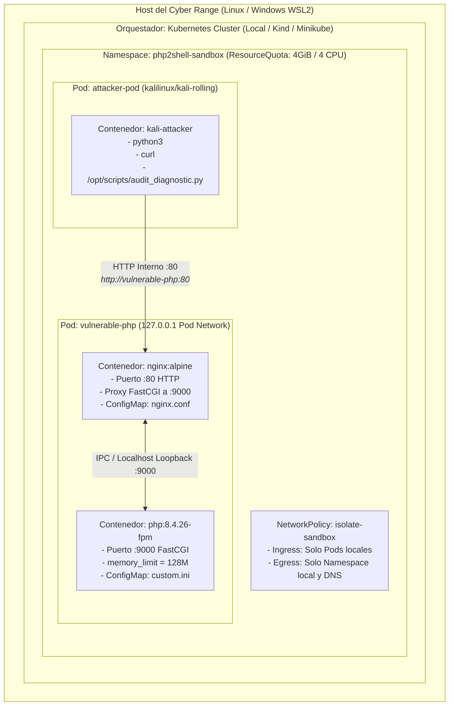
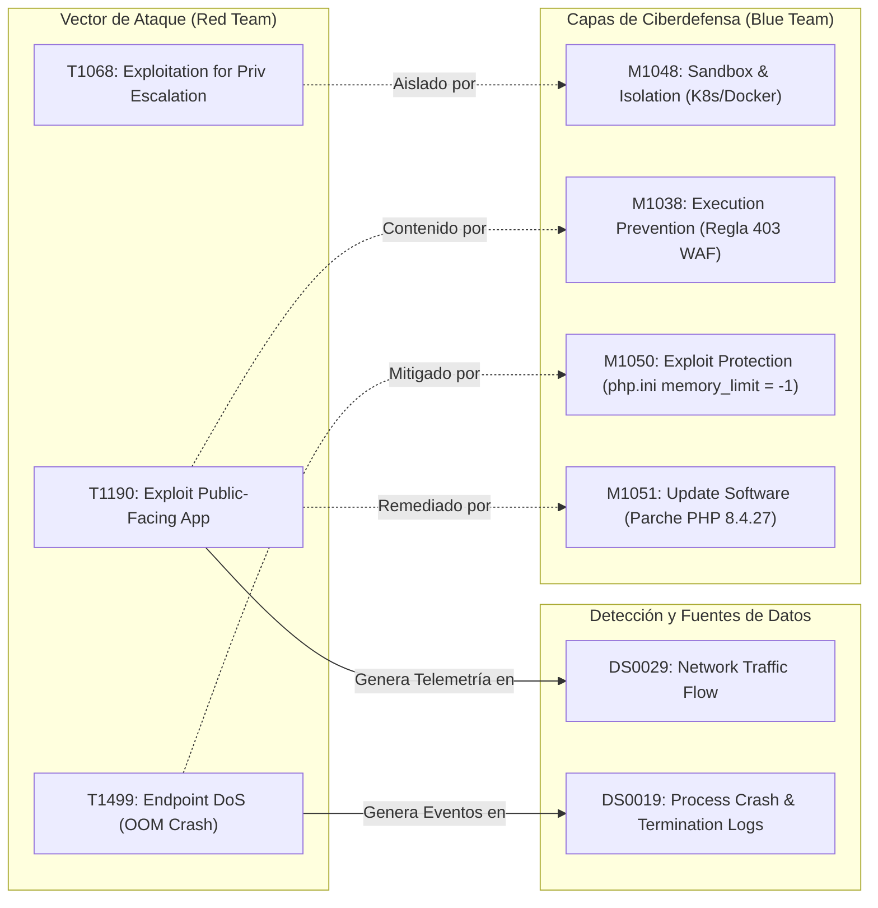

# DOCUMENTO DE DESCRIPCIÓN DE ARQUITECTURA (AD)
## Estándar ISO/IEC/IEEE 42010:2011 / 2022 mediante Metodología ARCADIA
### Sistema: *The Kodiak Shield CD Cyber Range - PHP2Shell Cleanroom Sandbox*
**Referencia de Amenaza:** CVE-2026-109618 / CVE-2026-109619 (CVSS 9.2 - RCE en Core de PHP)  
**Marco de Ciberseguridad Integrado:** MITRE ATT&CK® v16 (Enterprise Matrix)

---

## 1. MARCO METODOLÓGICO Y ALINEACIÓN DE ESTÁNDARES

### 1.1 El Estándar ISO/IEC/IEEE 42010
El estándar internacional **ISO/IEC/IEEE 42010** (*Systems and software engineering — Architecture description*) establece las bases para describir arquitecturas de sistemas y software de forma rigurosa y verificable. Su meta-modelo se fundamenta en:
* **Misión y Contexto del Sistema:** El propósito dentro de su entorno operativo.
* **Partes Interesadas (Stakeholders):** Individuos, equipos u organizaciones con intereses directos en el sistema.
* **Preocupaciones (Concerns):** Intereses críticos relativos al desarrollo, operación, seguridad, rendimiento y riesgos.
* **Puntos de Vista Arquitectónicos (Architecture Viewpoints):** Convenciones, patrones y reglas para construir vistas específicas que abordan las preocupaciones de los stakeholders.
* **Vistas Arquitectónicas (Architecture Views):** La representación concreta del sistema para un punto de vista dado.
* **Justificación Arquitectónica (Architecture Rationale):** Las razones explícitas que sustentan las decisiones de diseño tomadas frente a alternativas descartadas.

### 1.2 La Metodología ARCADIA
**ARCADIA** (*Architecture Analysis & Design Integrated Approach*) es el método de ingeniería de sistemas basado en modelos (MBSE) estructurado por Thales. Descompone la evolución de un sistema en cuatro perspectivas de ingeniería secuenciales y coherentes:



### 1.3 Mapeo ISO 42010 - ARCADIA - MITRE ATT&CK

| Elemento ISO 42010 | Perspectiva ARCADIA | Enfoque de Ciberseguridad & MITRE ATT&CK |
| :--- | :--- | :--- |
| **Operational Viewpoint** | **Análisis Operacional (OA)** | Objetivos del Adversario (Threat Actors) y de los Operadores Defensivos (Blue Team / Red Team). |
| **System Viewpoint** | **Análisis del Sistema (SA)** | Frontera del Sandbox, Capacidades del Sistema y Taxonomía de Técnicas de Ataque (MITRE ATT&CK Techniques). |
| **Logical Viewpoint** | **Arquitectura Lógica (LA)** | Descomposición en Funciones de Seguridad, Flujos de Información e Invariantes de Memoria. |
| **Physical Viewpoint** | **Arquitectura Física (PA)** | Despliegue en Kubernetes / Docker, Aislamiento de Red, Detección (Data Sources) y Mitigaciones (MITRE Mitigations). |

---

## 2. PARTES INTERESADAS (STAKEHOLDERS) Y PREOCUPACIONES (CONCERNS)



1. **Docente / Arquitecto del Cyber Range (ST-01):**
   * *Concern (CR-01):* Garantizar que la ejecución de vulnerabilidades críticas (CVSS 9.2) no comprometa el sistema operativo anfitrión (Host físico / Workstation del estudiante).
   * *Concern (CR-02):* Proporcionar entornos desechables y reproducibles con un solo comando.
2. **Estudiante de Hacking Ético / Red Team (ST-02):**
   * *Concern (CR-03):* Comprender cómo se manifiesta la corrupción de memoria en bajo nivel (C / `longjmp()`) sin requerir payloads destructivos no controlados.
3. **Analista de Ciberdefensa / Blue Team (ST-03):**
   * *Concern (CR-04):* Disponer de telemetría de logs y contención en capas (Perímetro HTTP 403, Hardening de configuración y Actualización de runtime).
4. **Oficial de Cumplimiento y Seguridad (ST-04):**
   * *Concern (CR-05):* Asegurar que todo el ejercicio cumpla con estándares éticos y defensivos, referenciados formalmente con la matriz MITRE ATT&CK.

---

## 3. PERSPECTIVA 1: ANÁLISIS OPERACIONAL (OPERATIONAL ANALYSIS - OA)

### 3.1 Misión Operacional
El objetivo operacional consiste en capacitar a ingenieros de ciberseguridad en la identificación, explotación conceptual controlada y mitigación escalonada de fallas críticas en tiempo de ejecución web (RCE en el núcleo de PHP).

### 3.2 Diagrama Operacional de Actividades y Entidades (OAB / OEB)



### 3.3 Mapeo MITRE ATT&CK en la Perspectiva Operacional

| Actividad Operacional | Actor | Táctica MITRE ATT&CK | Técnica / Subtécnica MITRE | ID |
| :--- | :---: | :--- | :--- | :--- |
| **OA-01: Reconocimiento** | Red Team | Reconnaissance (TA0043) | Gather Victim Host Information: Software | [T1592.002](https://attack.mitre.org/techniques/T1592/002/) |
| **OA-02: Inducción de Falla** | Red Team | Initial Access (TA0001) | Exploit Public-Facing Application | [T1190](https://attack.mitre.org/techniques/T1190/) |
| **OA-02b: Saturación OOM** | Red Team | Impact (TA0040) | Endpoint Denial of Service: OS Exhaustion | [T1499.001](https://attack.mitre.org/techniques/T1499/001/) |
| **OA-03: Telemetría de Logs** | Blue Team | Collection (TA0009) | Data from Information Repositories | [T1213](https://attack.mitre.org/techniques/T1213/) |
| **OA-04: Bloqueo Perimetral** | Blue Team | Defense Evasion / Mitigation | Execution Prevention: Network Filtering | [M1038](https://attack.mitre.org/mitigations/M1038/) |
| **OA-06: Parche Definitivo** | Blue Team | Vulnerability Mitigation | Update Software | [M1051](https://attack.mitre.org/mitigations/M1051/) |

---

## 4. PERSPECTIVA 2: ANÁLISIS DEL SISTEMA (SYSTEM ANALYSIS - SA)

### 4.1 Definición de la Frontera del Sistema ("Black Box")
En esta perspectiva, el Cyber Range se analiza como una caja negra que interactúa con actores externos a través de interfaces controladas:
* **Interfaz de Control (Host CLI):** Utilizada por el Docente para orquestar pods mediante `kubectl` o `docker compose`.
* **Interfaz de Auditoría (Red Console):** Sesión interactiva TTY dentro del pod atacante.
* **Interfaz de Servicio Interno (Target HTTP/FastCGI):** Canal virtualizado e inaccesible desde el host exterior.

### 4.2 Diagrama de Casos de Uso y Funciones del Sistema (SDF / SAB)



### 4.3 Análisis de Requisitos y Capacidades del Sistema

```
[CAP-01] Capacidad de Aislamiento Estructural
  ├── Traza a: CR-01 (Seguridad del Host)
  └── Función del Sistema: SF-01 (NetworkPolicy interna sin enlaces de host)

[CAP-02] Capacidad de Replicación del Defecto de Memoria (CVE-2026-109618)
  ├── Traza a: CR-03 (Comprensión de bajo nivel)
  └── Función del Sistema: SF-03 + SF-04 (Parseo multipart con límite estricto de 128M)

[CAP-03] Capacidad de Filtrado Defensivo Escalonado
  ├── Traza a: CR-04 (Mitigación Blue Team)
  └── Función del Sistema: SF-05 (Regla NGINX) y SF-06 (Rollout a imagen 8.4.27)
```

---

## 5. PERSPECTIVA 3: ARQUITECTURA LÓGICA (LOGICAL ARCHITECTURE - LA)

### 5.1 Principio de la Arquitectura Lógica
La Arquitectura Lógica descompone el sistema en **Componentes Lógicos (LC)** y define los intercambios de funciones de forma independiente de las tecnologías o marcas de implementación (Kubernetes, Docker, NGINX o Apache).

### 5.2 Componentes Lógicos del Sistema

1. **`LC_Perimeter_Gateway` (Pasarela Perimetral Lógica):**  
   Punto de entrada de las comunicaciones entrantes. Realiza el enrutamiento HTTP y la inspección superficial de cabeceras (`Content-Type`, `Content-Length`).
2. **`LC_Protocol_Adapter` (Adaptador de Protocolo de Aplicación):**  
   Transforma el tráfico HTTP externo en llamadas FastCGI hacia el motor de procesamiento.
3. **`LC_Parser_Subsystem` (Subsistema de Parseo de Cargas Útiles):**  
   Interpreta flujos codificados en `multipart/form-data`, asignando dinámicamente estructuras de datos en memoria para poblar variables de formulario.
4. **`LC_Memory_Manager_Core` (Gestor de Memoria y Manejo de Excepciones C):**  
   Gobierna la asignación (`malloc`), el límite de memoria del proceso y la rutina de salto no local (`longjmp()`).
5. **`LC_Session_Tracker` (Rastreador de Estado y Progreso de Sesión):**  
   Gestiona variables de progreso de subidas (`session.upload_progress`).
6. **`LC_Audit_Probe` (Sonda de Auditoría de Ciberseguridad):**  
   Genera secuencias de paquetes de diagnóstico controlados para medir la resiliencia del sistema.

### 5.3 Diagrama de Flujo y Arquitectura Lógica (LAB)



### 5.4 Análisis del Fallo Lógico de Memoria (Anatomía de `longjmp`)
* **Invariante Violada:** Todo bloque de memoria solicitado con reserva dinámica (`emalloc`) en el núcleo de PHP debe contar con un destructor en el bloque `zend_try` / `zend_catch`.
* **Mecanismo de Ruptura:** Al dispararse un error fatal durante la lectura del stream de entrada, la llamada directa a `longjmp()` salta la ejecución del código sin pasar por los bloques `zend_clean_variables` o de liberación de memoria intermedia.
* **Consecuencia Lógica:** Los registros y punteros de sesión (`session.upload_progress`) quedan referenciando direcciones de memoria marcadas como libres, abriendo la ventana temporal para **Use-After-Free (UAF)** y posterior ejecución remota arbitraria (RCE).

---

## 6. PERSPECTIVA 4: ARQUITECTURA FÍSICA (PHYSICAL ARCHITECTURE - PA)

### 6.1 Principio de la Arquitectura Física
La Arquitectura Física concreta la asignación de los Componentes Lógicos a **Nodos Físicos de Ejecución (Execution Nodes)**, contenedores, redes y piezas de software reales implementadas en el laboratorio.

### 6.2 Diagrama Físico de Despliegue (PAB / Deployment View)



### 6.3 Correspondencia de Componentes Lógicos a Nodos Físicos

| Componente Lógico (LA) | Implementación Física (PA) | Archivo de Configuración |
| :--- | :--- | :--- |
| `LC_Perimeter_Gateway` | Contenedor `nginx:alpine` | [k8s/01-target-pod.yaml](./k8s/01-target-pod.yaml) |
| `LC_Parser_Subsystem` | Motor `php:8.4.26-fpm` (Zend Engine) | [k8s/01-target-pod.yaml](./k8s/01-target-pod.yaml) |
| `LC_Memory_Manager_Core` | Configuración `php.ini` montada vía ConfigMap | [k8s/01-target-pod.yaml](./k8s/01-target-pod.yaml) |
| `LC_Audit_Probe` | Contenedor `kalilinux/kali-rolling` | [k8s/02-attacker-pod.yaml](./k8s/02-attacker-pod.yaml) |
| `LC_Isolation_Boundary` | K8s `NetworkPolicy` y Namespace dedicado | [k8s/00-namespace.yaml](./k8s/00-namespace.yaml) y [k8s/03-network-policy.yaml](./k8s/03-network-policy.yaml) |
| `LC_WAF_Mitigator` | Regla NGINX 403 Forbidden | [k8s/04-blue-mitigations.yaml](./k8s/04-blue-mitigations.yaml) |
| `LC_Patched_Core` | Imagen actualizada `php:8.4.27-fpm` | [k8s/05-runtime-patch.yaml](./k8s/05-runtime-patch.yaml) |

---

## 7. MATRIZ DE INTEGRACIÓN Y REFERENCIAS MITRE ATT&CK®

A continuación se detalla la correspondencia exhaustiva entre los artefactos físicos y lógicos del laboratorio y las tácticas, técnicas, mitigaciones y fuentes de datos de MITRE ATT&CK:



### 7.1 Catálogo Detallado de Técnicas MITRE ATT&CK

#### 1. Técnica [T1190: Exploit Public-Facing Application](https://attack.mitre.org/techniques/T1190/)
* **Táctica:** Initial Access ([TA0001](https://attack.mitre.org/tactics/TA0001/)).
* **Manifestación en el Lab:** Envío de una solicitud HTTP POST especialmente malformada con cabecera `Content-Type: multipart/form-data` al puerto 80 del servidor web.
* **Componente Involucrado:** `LC_Parser_Subsystem` / contenedor `target-php`.
* **Mitigaciones MITRE Asociadas:**
  * [M1051 (Update Software)](https://attack.mitre.org/mitigations/M1051/): Aplicar el parche oficial a `php:8.4.27-fpm`.
  * [M1038 (Execution Prevention)](https://attack.mitre.org/mitigations/M1038/): Regla de filtrado perimetral en NGINX.

#### 2. Técnica [T1499.001: Endpoint Denial of Service - OS Exhaustion](https://attack.mitre.org/techniques/T1499/001/)
* **Táctica:** Impact ([TA0040](https://attack.mitre.org/tactics/TA0040/)).
* **Manifestación en el Lab:** Saturación deliberada del búfer de memoria de PHP superando `memory_limit = 128M`, lo que fuerza la interrupción del worker de PHP-FPM con código de retorno HTTP 502 Bad Gateway.
* **Componente Involucrado:** `LC_Memory_Manager_Core`.
* **Mitigaciones MITRE Asociadas:**
  * [M1050 (Exploit Protection)](https://attack.mitre.org/mitigations/M1050/): Configurar `memory_limit = -1` para impedir que el disparador OOM sea predecible en el parseo inicial.

#### 3. Técnica [T1068: Exploitation for Privilege Escalation](https://attack.mitre.org/techniques/T1068/)
* **Táctica:** Privilege Escalation ([TA0004](https://attack.mitre.org/tactics/TA0004/)).
* **Manifestación en el Lab:** Manipulación del diseño de la memoria liberada por `longjmp()` para sobreescribir punteros de instrucción (UAF) y obtener una shell interactiva con privilegios `www-data` (UID 33).
* **Mitigaciones MITRE Asociadas:**
  * [M1048 (Application Isolation and Sandboxing)](https://attack.mitre.org/mitigations/M1048/): Restricción del contenedor en Kubernetes mediante `securityContext` sin privilegios (`runAsNonRoot: true`), y límites de cuota de CPU/memoria (`ResourceQuota`).

### 7.2 Catálogo de Fuentes de Datos para Monitoreo (Data Sources)

* **[DS0029 - Network Traffic: Network Traffic Flow](https://attack.mitre.org/datasources/DS0029/):**  
  Captura y auditoría del volumen y tipo MIME en peticiones POST entrantes.
* **[DS0019 - Process: Process Termination](https://attack.mitre.org/datasources/DS0019/):**  
  Supervisión de salidas anómalas de procesos `php-fpm` con señales `SIGSEGV` (código de salida 139) o cierres abruptos de socket mediante `kubectl logs -f deployment/vulnerable-php -c php-fpm`.

---

## 8. JUSTIFICACIÓN ARQUITECTÓNICA (ISO 42010 RATIONALE)

A continuación se documentan las decisiones de diseño fundamentales y la justificación de por qué se descartaron alternativas:

### Decisión 1: Despliegue en Pods Co-ubicados (Sidecar NGINX + PHP-FPM) vs PHP con Servidor Integrado
* **Decisión:** Implementar un Pod con dos contenedores compartiendo `localhost:9000` (NGINX como reverse proxy y PHP-FPM como intérprete).
* **Justificación:** PHP-FPM (`php:8.4.26-fpm`) no habla HTTP directamente sino FastCGI. Para que los estudiantes experimenten con la realidad de las empresas (NGINX/Apache frente a FPM) y prueben las reglas WAF de bloqueo HTTP 403, el proxy NGINX es obligatorio.
* **Alternativa Descartada:** Usar el servidor web integrado de PHP (`php -S 0.0.0.0:80`). Descartada porque el servidor integrado utiliza un modelo mono-hilo que no implementa el reciclaje de workers de PHP-FPM, impidiendo replicar el fallo de persistencia de estado global (CVE-2026-109619).

### Decisión 2: NetworkPolicy Estricta vs Exposición LoadBalancer
* **Decisión:** Mantener el objetivo `vulnerable-php` expuesto exclusivamente como `ClusterIP` interno, accesible únicamente desde el pod atacante `attacker-pod`.
* **Justificación:** Al tratarse de una vulnerabilidad crítica con CVSS 9.2 (RCE no autenticado), exponer un puerto directo hacia el Host físico del estudiante abriría una brecha en su estación frente a otros dispositivos de su red local (LAN/Wi-Fi).
* **Alternativa Descartada:** Usar `NodePort` o `LoadBalancer` directo en localhost. Descartada por violar la política de seguridad y aislamiento del estándar ISO 42010 (preocupación CR-01).

### Decisión 3: Arquitectura Dual K8s y Docker Compose
* **Decisión:** Ofrecer soporte simultáneo y equivalente para Kubernetes (`kind`/`minikube`) y Docker Compose.
* **Justificación:** Garantiza la máxima portabilidad pedagógica. Permite impartir el curso tanto en laboratorios universitarios con clústeres avanzados como en computadoras personales de estudiantes con recursos limitados.

---

## 9. MATRIZ DE TRAZABILIDAD TRANSVERSAL (TRACEABILITY MATRIX)

| ID Requisito | Stakeholder | Concern | Función Lógica | Componente Físico | Técnica MITRE ATT&CK | Mitigación MITRE |
| :---: | :---: | :---: | :---: | :---: | :---: | :---: |
| **REQ-01** | Docente | CR-01 (Aislamiento) | `LC_Isolation_Boundary` | `00-namespace.yaml` / `03-network-policy.yaml` | T1190 | [M1048](https://attack.mitre.org/mitigations/M1048/) |
| **REQ-02** | Red Team | CR-03 (Falla Core) | `LC_Parser_Subsystem` | `target-php` (`php:8.4.26-fpm`) | [T1499.001](https://attack.mitre.org/techniques/T1499/001/) | [M1050](https://attack.mitre.org/mitigations/M1050/) |
| **REQ-03** | Red Team | CR-03 (Auditoría) | `LC_Audit_Probe` | `02-attacker-pod.yaml` (`audit_diagnostic.py`) | [T1592.002](https://attack.mitre.org/techniques/T1592/002/) | - |
| **REQ-04** | Blue Team | CR-04 (Filtrado WAF) | `LC_Perimeter_Gateway` | `04-blue-mitigations.yaml` (Regla 403 NGINX) | [T1190](https://attack.mitre.org/techniques/T1190/) | [M1038](https://attack.mitre.org/mitigations/M1038/) |
| **REQ-05** | Blue Team | CR-04 (Parche Oficial) | `LC_Patched_Core` | `05-runtime-patch.yaml` (`php:8.4.27-fpm`) | [T1190](https://attack.mitre.org/techniques/T1190/) | [M1051](https://attack.mitre.org/mitigations/M1051/) |
