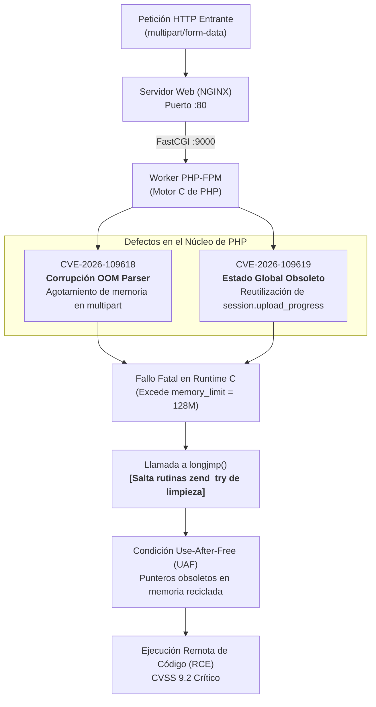
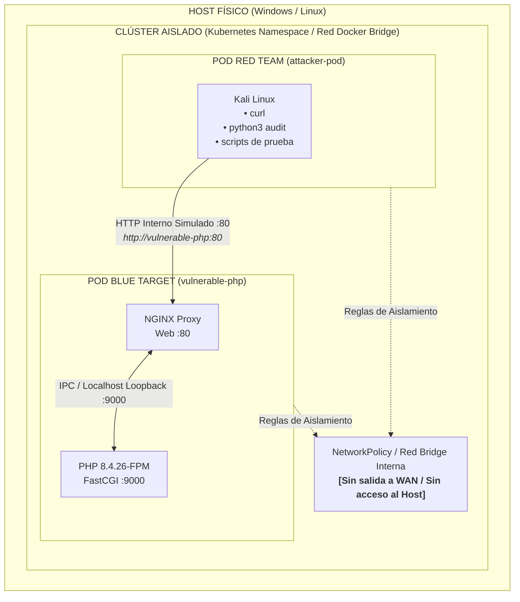
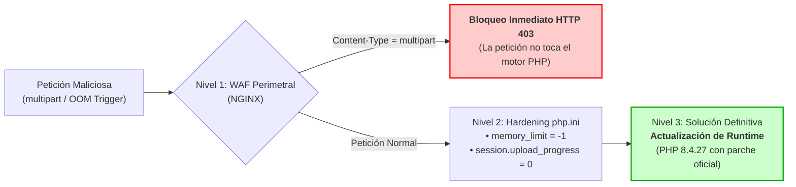

# GUÍA DE LABORATORIO PRÁCTICO: HACKING ÉTICO & CIBERDEFENSA
## Masterclass en PHP2Shell (CVE-2026-109618 y CVE-2026-109619)

---

### FICHA TÉCNICA DEL LABORATORIO
- **Nivel:** Intermedio - Avanzado (Hacking Ético / Blue Team / AppSec).
- **Duración Estimada:** 2 a 3 Horas.
- **Enfoque:** Red Team (Auditoría y Análisis de Fallas) vs. Blue Team (Triage, Mitigación y Remediación).
- **Entorno:** Clúster Kubernetes aislado (`kind` / `minikube` / Docker Compose) en entorno desechable.
- **Vulnerabilidad Analizada:** CVSS 9.2 (Crítico) - RCE no autenticado por corrupción de memoria y `longjmp()` en el núcleo de PHP.

---

## 1. FUNDAMENTOS TEÓRICOS Y ANATOMÍA DE LA VULNERABILIDAD

### 1.1 El Núcleo del Problema: ¿Por qué falla PHP Core?
A diferencia de las vulnerabilidades tradicionales en aplicaciones web (como inyección SQL o XSS), **PHP2Shell reside en el propio motor de PHP en C**, afectando a cualquier servidor web que procese peticiones HTTP (PHP-FPM, Apache `mod_php`, PHP-CGI) independientemente de qué CMS o framework esté instalado (WordPress, Drupal, Magento o código personalizado).



### 1.2 La Mecánica de `longjmp()`
1. **Asignación:** PHP reserva memoria dinámica para estructurar los arrays globales (`$_POST`, `$_FILES`).
2. **Excepción OOM:** Cuando la petición excede el umbral configurado (`memory_limit`), el motor de PHP ejecuta un salto no local mediante la función estándar de C `longjmp()`.
3. **Omisión de Destructores:** `longjmp()` desbobina la pila sin ejecutar las funciones de limpieza (`zend_try`, destructores de buffers y liberación de punteros temporales).
4. **Use-After-Free (UAF):** La memoria queda marcada como reutilizable, pero los punteros internos aún referencian fragmentos del buffer previo. Si el worker de PHP-FPM se reutiliza para procesar solicitudes posteriores, el atacante puede forzar la lectura o ejecución de memoria arbitraria.

---

## 2. TOPOLOGÍA DEL LABORATORIO

Para garantizar la seguridad del Host, el laboratorio opera en una **red virtualizada estricta y desechable**, sin exponer puertos mediante LoadBalancer hacia el exterior.



---

## 3. INSTRUCCIONES PASO A PASO

### OPCIÓN A: Despliegue en Kubernetes (Recomendado según Diapositivas 8-10)

#### Paso 1: Inicialización del Clúster y Namespace
Abra su terminal (PowerShell o Bash) y cree el namespace aislado:
```bash
# 1. Crear el namespace seguro
kubectl apply -f k8s/00-namespace.yaml

# 2. Establecer el namespace de trabajo por defecto
kubectl config set-context --current --namespace=php2shell-sandbox
```

#### Paso 2: Despliegue de los Pods (Objetivo y Auditor)
```bash
# Desplegar el target vulnerable (PHP 8.4.26-FPM + Nginx)
kubectl apply -f k8s/01-target-pod.yaml

# Desplegar el pod atacante (Kali Linux)
kubectl apply -f k8s/02-attacker-pod.yaml

# Aplicar las políticas de aislamiento de red
kubectl apply -f k8s/03-network-policy.yaml
```

Verifique que ambos pods se encuentren en estado `Running`:
```bash
kubectl get pods -w
```

---

### OPCIÓN B: Despliegue Rápido con Docker Compose
Si su estación no dispone de Kubernetes activo:
```bash
# Navegar a la carpeta docker-compose y levantar los contenedores
cd docker-compose
docker compose up -d

# Verificar el estado
docker compose ps
```

---

## 4. FASE DE RECONOCIMIENTO Y AUDITORÍA (RED TEAM)

### Paso 4.1: Acceso a la Consola de Auditoría
Ingrese al contenedor de Kali Linux:

- **En Kubernetes:**
  ```bash
  kubectl exec -it attacker-pod -- /bin/bash
  ```
- **En Docker Compose:**
  ```bash
  docker exec -it attacker-kali /bin/bash
  ```

### Paso 4.2: Huella del Runtime y Límites de Memoria
Desde el pod atacante, ejecute un reconocimiento HTTP contra el objetivo:
```bash
# En K8s el nombre de host es vulnerable-php; en Docker es web-target
curl -s http://vulnerable-php:80 | jq . || curl -s http://vulnerable-php:80
```

> **Pregunta para el estudiante 1:**  
> Observe los valores devueltos en `php_version`, `memory_limit` y `session_upload_progress`.  
> ¿Por qué un `memory_limit` estándar de `128M` facilita la activación de la vulnerabilidad CVE-2026-109618 frente a un valor no acotado?

### Paso 4.3: Ejecución de la Auditoría Diagnóstica
Ejecute el script de análisis incorporado en `/opt/scripts`:
```bash
python3 /opt/scripts/audit_diagnostic.py --target http://vulnerable-php:80 --size 2
```

**Análisis de Resultados:**
1. Observe la respuesta del servidor ante la cabecera `multipart/form-data`.
2. En una segunda terminal en el Host, monitoree los logs del pod vulnerable en tiempo real:
   ```bash
   kubectl logs -f deployment/vulnerable-php -c php-fpm
   ```
3. Registre si se producen errores del tipo `Fatal error: Allowed memory size of X bytes exhausted` o si el worker se reinicia silenciosamente.

---

## 5. FASE DE CONTENCIÓN Y MITIGACIÓN (BLUE TEAM)

El equipo de ciberdefensa debe aplicar una estrategia de **Defensa en Profundidad** escalonada mientras se coordina la ventana de mantenimiento para actualizar el runtime:



### Nivel 1: Bloqueo Perimetral en el Servidor Web (NGINX)
Dado que el vector de activación de CVE-2026-109618 depende de peticiones `multipart/form-data`, configure el servidor web para bloquearlas en la puerta de enlace:

```nginx
# Regla Blue Team en NGINX
if ($http_content_type ~* "multipart/form-data") {
    return 403 "Blocked by Blue Team WAF Filter: multipart prohibited\n";
}
```

### Nivel 2: Blindaje de Configuración de PHP (`php.ini`)
Para mitigar ambas vulnerabilidades (CVE-2026-109618 y CVE-2026-109619):
1. **Para CVE-2026-109618:** Fijar `memory_limit = -1`. Esto elimina el umbral artificial que dispara el `longjmp()` temprano durante la fase de parseo inicial.
2. **Para CVE-2026-109619:** Fijar `session.upload_progress.enabled = 0`. Esto deshabilita el subsistema de rastreo de progreso de subidas, impidiendo que el estado global persista en memoria reciclada.

### Aplicación del Parche de Mitigación en el Laboratorio:
- **En Kubernetes:**
  ```bash
  kubectl apply -f k8s/04-blue-mitigations.yaml
  kubectl rollout restart deployment/vulnerable-php
  ```
- **En Docker Compose:**
  ```bash
  # Cambie la referencia del volumen en docker-compose.yml a php-mitigated.ini y nginx-mitigated.conf
  docker compose restart
  ```

### Verificación de la Defensa:
Desde el contenedor atacante, repita la auditoría:
```bash
python3 /opt/scripts/audit_diagnostic.py --target http://vulnerable-php:80 --check-mitigation
```
> **Resultado Esperado:** El servidor debe retornar **HTTP 403 Forbidden** inmediatamente, confirmando que la solicitud maliciosa ni siquiera llega al intérprete de PHP.

> **Pregunta para el estudiante 2:**  
> ¿Qué impacto en el negocio tiene la mitigación perimetral de NGINX? ¿Qué funcionalidades legítimas del portal web de una empresa dejarían de operar?

---

## 6. FASE DE REMEDIACIÓN DEFINITIVA: ACTUALIZACIÓN DEL RUNTIME

Como destaca la diapositiva 14 del material:  
*"Las configuraciones y WAF solo compran tiempo. La única remediación efectiva es actualizar el ejecutable de PHP."*

### Matriz de Versiones Parcheadas:
- Rama 8.5 ➔ Parcheada en **8.5.12**
- Rama 8.4 ➔ Parcheada en **8.4.27**
- Rama 8.3 ➔ Parcheada en **8.3.36**
- Rama 8.2 ➔ Parcheada en **8.2.35**
- *Ramas EOL (8.1 o inferiores):* No reciben soporte oficial; requieren migración urgente.

### Aplicación de la Actualización en Kubernetes:
```bash
kubectl apply -f k8s/05-runtime-patch.yaml
kubectl rollout status deployment/vulnerable-php
```

Compruebe la nueva versión activa:
```bash
curl -s http://vulnerable-php:80 | grep "php_version"
```

---

## 7. CUESTIONARIO DE EVALUACIÓN Y RETO FINAL

1. **Análisis de Arquitectura:** Explique la diferencia entre una vulnerabilidad en una aplicación web escrita en PHP (ej. un plugin vulnerable) y una falla en el Core de PHP (como PHP2Shell).
2. **Mecanismo de Explotación:** ¿Por qué la función de biblioteca `longjmp()` de C resulta peligrosa cuando se invoca dentro de un gestor de errores en un proceso multipetición como PHP-FPM?
3. **Evasión de Defensas:** Si un analista Blue Team solo implementa la regla de NGINX pero el atacante utiliza métodos HTTP alternativos o túneles internos que no pasan por ese NGINX específico, ¿qué sucede?
4. **Reto Práctico:** Configure un contenedor de monitoreo con `tcpdump` o `Falco` para alertar cuando un proceso `php-fpm` muera con una señal de violación de segmento (`SIGSEGV` o código 139).
