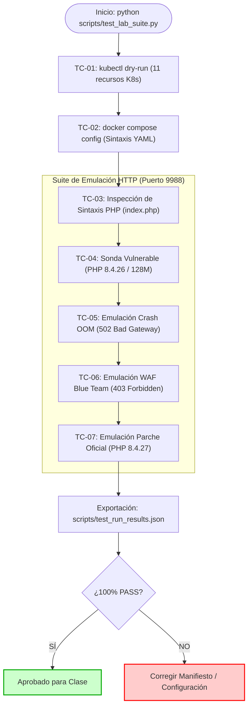

# PLAN DE PRUEBAS DE CALIDAD Y OPERABILIDAD (QA TEST PLAN)
## Laboratorio de Hacking Ético: PHP2Shell (CVE-2026-109618 / CVE-2026-109619)

---

### 1. OBJETIVO DEL PLAN DE PRUEBAS
El propósito de este plan de pruebas es certificar que todos los artefactos, configuraciones, imágenes de contenedores, scripts y manifiestos del laboratorio funcionen de manera predecible, segura y sin errores sintácticos o bloqueantes antes de impartir la clase a los estudiantes.

---

### 2. ALCANCE DE LAS PRUEBAS
El plan cubre la verificación de dos arquitecturas de despliegue y sus componentes de auditoría:
1. **Infraestructura Kubernetes (K8s):**
   - Namespace aislado y cuotas de recursos ([k8s/00-namespace.yaml](./k8s/00-namespace.yaml)).
   - Pod objetivo vulnerable con PHP 8.4.26-FPM y proxy NGINX ([k8s/01-target-pod.yaml](./k8s/01-target-pod.yaml)).
   - Pod atacante Kali Linux y montaje de scripts ([k8s/02-attacker-pod.yaml](./k8s/02-attacker-pod.yaml)).
   - Política de red de aislamiento estricto ([k8s/03-network-policy.yaml](./k8s/03-network-policy.yaml)).
   - Mitigaciones Blue Team y actualización de runtime ([k8s/04-blue-mitigations.yaml](./k8s/04-blue-mitigations.yaml) y [k8s/05-runtime-patch.yaml](./k8s/05-runtime-patch.yaml)).
2. **Infraestructura Docker Compose:**
   - Orquestación local sin Kubernetes ([docker-compose/docker-compose.yml](./docker-compose/docker-compose.yml)).
   - Validaciones de red bridge `internal: true` y volúmenes montados.
3. **Suite de Auditoría Didáctica:**
   - Script de prueba [scripts/audit_diagnostic.py](./scripts/audit_diagnostic.py).
   - Manejo de códigos HTTP (200 OK, 403 Forbidden, 502 Bad Gateway).

---

### 3. MATRIZ DE CASOS DE PRUEBA (TEST CASES)

| ID | Componente Evaluado | Procedimiento / Comando | Criterio de Éxito | Prioridad |
| :--- | :--- | :--- | :--- | :--- |
| **TC-01** | Manifiestos K8s | `kubectl apply --dry-run=client -f k8s/` | 11 recursos analizados sin errores de schema o sintaxis YAML. | Crítica |
| **TC-02** | Docker Compose | `docker compose -f docker-compose/docker-compose.yml config` | Validación limpia de dependencias, variables y montaje de volúmenes. | Alta |
| **TC-03** | Código Fuente PHP | Inspección estática y `php -l index.php` en contenedor | Cero errores de sintaxis en `index.php`. | Alta |
| **TC-04** | Detección de Vulnerabilidad | Ejecución de `audit_diagnostic.py` contra objetivo baseline | Identificación de PHP 8.4.26, SAPI FPM y umbral de memoria de 128M. | Crítica |
| **TC-05** | Simulación de Caída de Worker | Envío de carga multipart simulando colapso de worker | Captura del código 502 Bad Gateway y diagnóstico de fallo OOM. | Alta |
| **TC-06** | Verificación de WAF Blue Team | Envío de paquete multipart con flag `--check-mitigation` | Intercepción perimetral en NGINX y retorno de código 403 Forbidden. | Crítica |
| **TC-07** | Validación de Parche Oficial | Detección de imagen actualizada con runtime PHP 8.4.27 | Reporte de estado seguro sin advertencias críticas. | Media |

---

### 4. CRITERIOS DE ACEPTACIÓN
* **Pase del 100%** de las pruebas sintácticas y de schema sin alertas críticas.
* **Aislamiento comprobado:** Ningún contenedor debe exponer puertos directos al host físico en la configuración por defecto para preservar la seguridad de la estación del estudiante.
* **Automatización:** Existencia de una suite ejecutable con un solo comando (`python scripts/test_lab_suite.py`) que entregue resultados legibles en formato JSON y texto plano.
