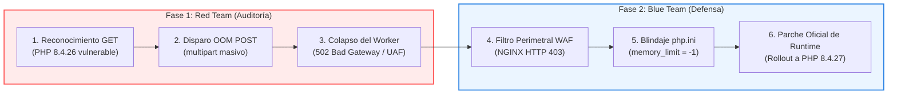
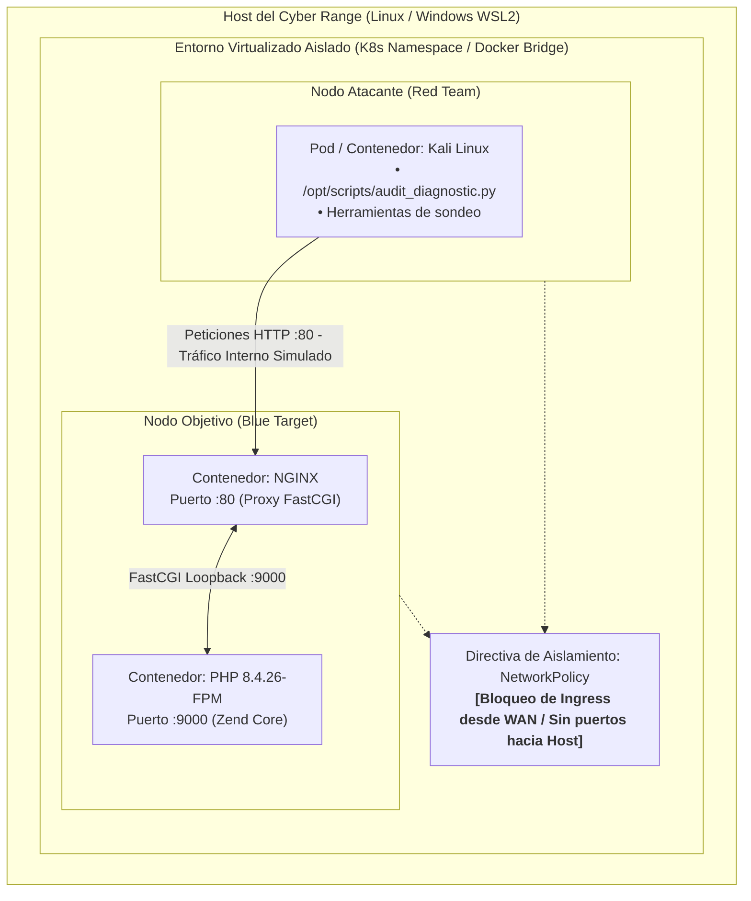

# The Kodiak Shield CD Cyber Range: Masterclass en PHP2Shell
## Entorno de Pruebas Didáctico para Clases de Hacking Ético y Ciberdefensa
**Vulnerabilidades:** CVE-2026-109618 (OOM Use-After-Free) y CVE-2026-109619 (Global State Stale Reference)  
**Severidad:** CVSS 9.2 (Crítico) - RCE No Autenticado en el Core de PHP

---

## 📌 1. Resumen Ejecutivo del Laboratorio
A partir del análisis exhaustivo de la arquitectura de la Masterclass, se extraen los siguientes componentes estructurales:

1. **Naturaleza del Fallo:**
   - No es un error en código PHP de usuario (WordPress, Drupal, Magento, etc.), sino un fallo interno en el motor escrito en C de PHP.
   - Ocurre cuando el parseo inicial de peticiones masivas `multipart/form-data` excede `memory_limit`, invocando la función de C `longjmp()`.
   - `longjmp()` interrumpe la ejecución sin ejecutar rutinas normales de limpieza, provocando un estado de **Use-After-Free (UAF)**. Al ser reciclado el worker en PHP-FPM, los punteros corruptos permiten el secuestro del flujo de ejecución de instrucciones.
2. **Filosofía del Laboratorio:**
   - Despliegue en **Cleanroom / Sandbox flotante y desechable** mediante contenedores (Kubernetes `kind` o Docker aislado).
   - Estricto aislamiento de red: **sin exposición externa** ni balanceadores de carga hacia el Host físico.
3. **Estrategia Didáctica Dual:**
   - **Red Team:** Comprensión de la anatomía del fallo, verificación de umbrales y auditoría diagnóstica de la memoria.
   - **Blue Team:** Contención perimetral (NGINX WAF rechazando `multipart/form-data` con 403), endurecimiento en `php.ini` (`memory_limit = -1`, `session.upload_progress.enabled = 0`) y la solución definitiva (actualización a `php:8.4.27-fpm`).



---

## 📂 2. Estructura del Proyecto

```
PHP-Exploit/
├── README.md                                     # Guía para el Instructor y Visión General
├── ARQUITECTURA_ISO42010_ARCADIA.md              # Documento de Arquitectura ISO 42010 (ARCADIA & MITRE)
├── GUIA_LABORATORIO_ESTUDIANTE.md                 # Manual paso a paso para los estudiantes
├── PLAN_DE_PRUEBAS.md                            # Plan formal de pruebas de calidad (QA)
├── REPORTE_PRUEBAS_LABORATORIO.md                # Reporte de ejecución y hallazgos
│
├── k8s/                                          # Despliegue Kubernetes (Kind / Minikube)
│   ├── 00-namespace.yaml                         # Namespace 'php2shell-sandbox' y ResourceQuota
│   ├── 01-target-pod.yaml                        # Pod objetivo (PHP 8.4.26-FPM + NGINX + ConfigMaps)
│   ├── 02-attacker-pod.yaml                      # Pod atacante (Kali Linux con script de auditoría)
│   ├── 03-network-policy.yaml                    # Aislamiento estricto de red
│   ├── 04-blue-mitigations.yaml                  # ConfigMap con reglas 403 y php.ini mitigado
│   └── 05-runtime-patch.yaml                     # Parche definitivo actualizando a PHP 8.4.27
│
├── docker-compose/                               # Alternativa rápida lista para usar
│   ├── docker-compose.yml                        # Red bridge aislada con Kali, PHP 8.4.26 y NGINX
│   ├── src/index.php                             # Script de diagnóstico de memoria y SAPI
│   ├── php/
│   │   ├── php.ini                               # Configuración vulnerable por defecto
│   │   └── php-mitigated.ini                     # Configuración endurecida (Blue Team)
│   └── nginx/
│       ├── nginx.conf                            # Proxy FastCGI estándar
│       └── nginx-mitigated.conf                  # Proxy con filtro perimetral WAF (403 Forbidden)
│
└── scripts/
    ├── audit_diagnostic.py                       # Herramienta de auditoría y análisis de respuestas HTTP
    ├── deploy_k8s.ps1                            # Automatización de despliegue en K8s (PowerShell)
    └── deploy_docker.ps1                         # Automatización de despliegue en Docker (PowerShell)
```

---

## 🏗️ 3. Arquitectura de Aislamiento del Laboratorio



---

## 🚀 4. Guía Rápida de Despliegue para la Clase

### Opción 1: Despliegue con Kubernetes (Recomendado)
```powershell
# Ejecute el script automatizado:
.\scripts\deploy_k8s.ps1

# O manualmente:
kubectl apply -f k8s/00-namespace.yaml
kubectl apply -f k8s/01-target-pod.yaml
kubectl apply -f k8s/02-attacker-pod.yaml
kubectl apply -f k8s/03-network-policy.yaml
```

### Opción 2: Despliegue con Docker Compose
```powershell
# Iniciar el laboratorio en un solo comando:
.\scripts\deploy_docker.ps1
```

---

## 🎓 5. Solucionario para el Instructor (Preguntas de Evaluación)

| Pregunta de la Guía | Respuesta Técnica Esperada |
| :--- | :--- |
| **1. Impacto de `memory_limit = 128M` vs no acotado** | Un límite predecible como `128M` permite al atacante calcular con exactitud los bytes necesarios en la cabecera `multipart` para forzar la interrupción por OOM durante el parseo de cadenas sin esperar que el servidor agote toda la RAM del host físico. |
| **2. Consecuencias de bloquear `multipart/form-data`** | Bloquea la subida legítima de archivos (avatares, documentos PDF, facturas, formularios con adjuntos). Rompe partes sustanciales de tiendas virtuales y portales empresariales. Es una medida temporal de emergencia. |
| **3. Riesgo de `longjmp()` en C** | `longjmp()` realiza un salto incondicional en el stack que omite destructores y rutinas de desasignación estándar. Deja objetos asignados huérfanos con punteros activos en la tabla de símbolos (Use-After-Free), comprometiendo peticiones futuras del mismo worker. |
| **4. Solución definitiva** | Actualizar el motor de PHP a una versión donde el parser de multipart y el gestor de subidas no invoquen `longjmp()` sin salvaguardar la coherencia de la memoria (`8.4.27`, `8.3.36`, `8.2.35` o `8.5.12`). |

---

## 🛡️ 6. Principios Éticos y de Seguridad
Este laboratorio ha sido diseñado con propósitos estrictamente **educativos y de ciberdefensa defensiva**. No incluye generadores de shellcode malicioso ni exploits destructivos de un clic; se centra en el análisis de causa raíz, auditoría de memoria, contención WAF y actualización de runtimes.
