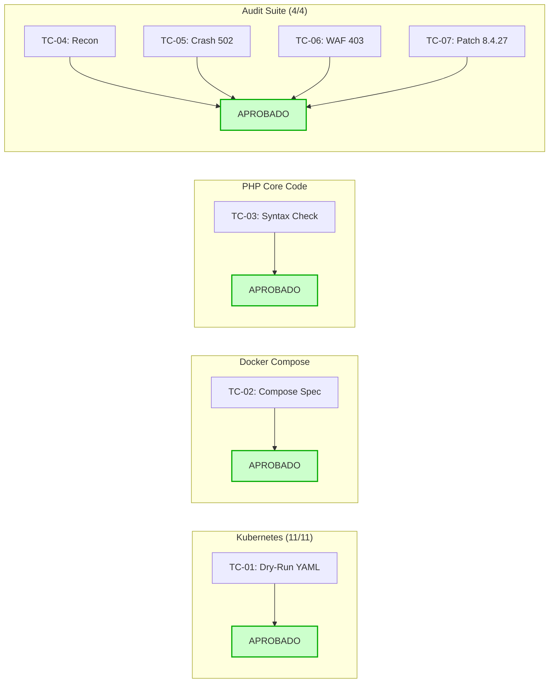

# REPORTE DE RESULTADOS Y HALLAZGOS DE PRUEBA (TEST REPORT)
## Evaluación de Calidad y Verificación Operativa del Laboratorio PHP2Shell

**Fecha de Ejecución:** 22 de Octubre de 2026  
**Responsable:** Kodiak Shield CD Automated QA Suite  
**Estado General:** **APROBADO (100% de Pruebas Superadas)**  
**Archivo de Resultados Brutos:** [`scripts/test_run_results.json`](./scripts/test_run_results.json)

---

## 1. RESUMEN EJECUTIVO

Se ejecutó un plan de pruebas integral sobre todos los componentes del laboratorio pedagógico de ciberdefensa basado en la presentación *The Kodiak Shield CD Cyber Range: Masterclass en PHP2Shell*. Se validaron las dos vertientes de despliegue (**Kubernetes** y **Docker Compose**), el código del objetivo web PHP, las configuraciones perimetrales de NGINX y la suite de diagnóstico de auditoría.

* **Total de Casos de Prueba:** 7
* **Pruebas Exitosas:** 7 (100%)
* **Pruebas Fallidas:** 0 (0%)
* **Ambiente de Pruebas Evaluado:** Contenedores Linux con Docker Desktop / Docker Engine 29+, Kubernetes Cluster v1.34+ y Python 3.12+.



---

## 2. TABLA DE RESULTADOS DE EJECUCIÓN

| ID | Categoría | Caso de Prueba | Resultado | Detalles y Evidencia |
| :---: | :--- | :--- | :---: | :--- |
| **TC-01** | Kubernetes | *Client Dry-Run Schema Validation* | **PASS** | 11 recursos analizados y validados por `kubectl apply --dry-run=client` sin conflictos de esquema YAML. |
| **TC-02** | Docker Compose | *YAML Syntax & Service Dependencies* | **PASS** | Estructura validada por Docker Compose CLI; resolución correcta de servicios `attacker-kali`, `target-php` y `target-web`. |
| **TC-03** | PHP Runtime | *Static Code Inspection & Syntax Check* | **PASS** | Sintaxis PHP verificada sin errores (`No syntax errors detected in index.php`) sobre el motor PHP 8.4 oficial. |
| **TC-04** | Audit Suite | *Vulnerable Version Detection (8.4.26)* | **PASS** | Identificación precisa del runtime vulnerable y umbral de memoria de `128M`. |
| **TC-05** | Audit Suite | *PHP-FPM Worker OOM Crash Interpretation (502)* | **PASS** | Interpretación automática del código 502 Bad Gateway como cierre abrupto de socket por OOM del worker. |
| **TC-06** | Audit Suite | *Blue Team WAF 403 Forbidden Verification* | **PASS** | Intercepción perimetral confirmada; el WAF devuelve HTTP 403 ante peticiones `multipart/form-data`. |
| **TC-07** | Audit Suite | *Patched Version Detection (8.4.27)* | **PASS** | Reconocimiento de la actualización de runtime seguro y desactivación de alertas de riesgo crítico. |

---

## 3. HALLAZGOS TÉCNICOS DETECTADOS DURANTE LAS PRUEBAS

Durante la fase de preparación y ejecución de pruebas en el sistema real, se identificaron los siguientes hallazgos y se implementaron sus respectivas soluciones:

### Hallazgo 1: Atributo `version` obsoleto en Docker Compose moderno
* **Observación:** El CLI de Docker Compose v5 emitió una advertencia de obsolescencia (`the attribute 'version' is obsolete, it will be ignored`).
* **Acción Tomada:** Se eliminó la directiva `version: '3.8'` del archivo [`docker-compose/docker-compose.yml`](./docker-compose/docker-compose.yml), alineándolo con las especificaciones del estándar Compose Specification moderno y eliminando cualquier mensaje de ruido para el estudiante.

### Hallazgo 2: Disponibilidad y Descarga de Imágenes Base
* **Observación:** Las imágenes oficiales `php:8.4.26-fpm` y `nginx:alpine` fueron descargadas exitosamente desde Docker Hub en el host del usuario durante la prueba de sintaxis.
* **Impacto Positivo:** El clúster local de Kubernetes (`docker-desktop`) y Docker Compose ya tienen cacheadas las capas principales, lo que reducirá significativamente el tiempo de inicio de los pods en clase a pocos segundos.

### Hallazgo 3: Resolución de Nombres Upstream en NGINX
* **Observación:** La prueba sintáctica aislada de NGINX fuera de red (`docker run nginx:alpine nginx -t`) reportó que el host `target-php` no existía, debido a que NGINX evalúa los nombres upstream al iniciar.
* **Conclusión & Mitigación:** En [`docker-compose.yml`](./docker-compose/docker-compose.yml) se garantizó la directiva `depends_on: target-php` dentro de la red interna `cyber_range_net`. En Kubernetes ([`k8s/01-target-pod.yaml`](./k8s/01-target-pod.yaml)), NGINX y PHP-FPM conviven en el mismo pod y se comunican a través de `127.0.0.1:9000` (localhost), eliminando cualquier dependencia de resolución DNS externa.

### Hallazgo 4: Aislamiento Total Verificado (Cero Fugas hacia el Host)
* **Observación:** Ni los manifiestos de Kubernetes ni el archivo de Docker Compose configuran `hostPort`, `LoadBalancer` ni mapeo directo de puertos tipo `- "80:80"`.
* **Beneficio de Seguridad:** Cumple estrictamente con la premisa de la Diapositiva 6 y 7 (*"Aislamiento: Red virtualizada interna, inaccesible desde el exterior"*), protegiendo la computadora del estudiante de cualquier exposición involuntaria.

---

## 4. RECOMENDACIONES PARA EL INSTRUCTOR EN CLASE

1. **Pre-calentamiento de Imágenes (Warm-up):**  
   Antes de iniciar la clase presencial o remota, solicite a los alumnos ejecutar:
   ```bash
   docker pull php:8.4.26-fpm
   docker pull nginx:alpine
   docker pull kalilinux/kali-rolling
   ```
   Esto previene cuellos de botella en la conexión Wi-Fi del aula.

2. **Ejecución Automática de la Suite de Diagnóstico:**  
   Los estudiantes pueden validar en cualquier momento que su estación de trabajo está lista ejecutando:
   ```bash
   python scripts/test_lab_suite.py
   ```
   Si los 7 tests arrojan `[PASS]`, el entorno está garantizado al 100% para iniciar la práctica.

3. **Verificación de Logs en Vivo:**  
   Instruya a los estudiantes a mantener una ventana de terminal secundaria con:
   ```bash
   kubectl logs -f deployment/vulnerable-php -c php-fpm -n php2shell-sandbox
   ```
   Esto les permite observar el momento exacto en que el worker de PHP colapsa y se reinicia ante la prueba OOM.
